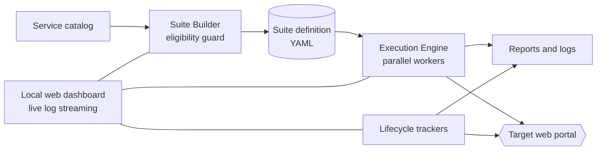

# Web Portal Test Automation Platform

> **Internal project. The source code is not public.**
> This page describes the design and the engineering problems behind it. It contains no proprietary code, data, URLs or screenshots.

**Status:** in active development and hardening (2026 to present)
**Role:** Owner and developer
**Stack:** Python, Playwright, Selenium, Flask, Socket.IO, YAML, Faker, Chart.js, PyInstaller

---

## What it is

A platform that automates end-to-end testing of a large, form-heavy government e-services portal (60+ services). It logs in once (including QR-code login), discovers each service's form at runtime, fills it with realistic multilingual test data, corrects its own validation errors, and reports the outcome of every run. Companion tools track submitted applications and notifications after submission and clean up drafts. The platform support multiple parallel workers.

It started as a personal attempt to remove repetitive manual testing and grew into five integrated tools behind one dashboard.

## The five tools

| Tool | Purpose |
|---|---|
| **Service Test Runner** | Runs one service, a batch or a suite, with live logs and Start / Pause / Resume / Stop / Skip controls and a dry-run, headless mode |
| **Suite Builder** | Composes reusable test suites (.yaml) from a service catalog, with an eligibility guard that blocks incompatible login types before a run starts |
| **Applications Tracker** | Follows submitted applications through their status changes (pending, approved, rejected..) and builds matched/unmatched reports |
| **Notifications Tracker** | Collects and parses portal notifications per application |
| **Draft Cleanup** | Counts and deletes drafts with confirmation, optionally filtered by service |

## Architecture

Everything runs on the user's machine: a local web server, no cloud dependency, packaged as a single Windows executable for people without a Python install.

## Engineering problems and approaches

- **Forms with no stable selectors.** Fields are discovered at runtime by scanning the DOM, classified into seven types (text, textarea, date, radio, dropdown, checkbox, table) and filled by type-specific handlers. Conditional fields that appear after other answers are caught by repeated rescans.
- **Multilingual test data.** A multi-level locale detector (field label markers, script detection, URL locale fallback) decides whether a field needs Arabic, French or English data. Conflict protection stops a generator of the wrong script from filling a field. Persona profiles keep related values consistent.
- **Self-correcting input.** After each fill the engine blurs the field, reads the portal's validation message, parses the constraint (length, script, numeric, date), regenerates a compliant value and retries within a fixed budget.
- **Logging in once, running in parallel.** One worker authenticates (including QR-code login); the others inherit the session from a cloned browser profile, so parallel runs don't repeat the login.
- **Single-page-app timing.** Login state is detected by waiting for server-rendered content to settle after hydration, instead of trusting the first render.
- **Human-like date pickers.** Dates are set by navigating the calendar widget cell by cell, not by typing, to match real user behaviour. Range pickers with length limits are handled by walking the window in hops.
- **Control and safety.** Cooperative stop, pause and skip checkpoints throughout the engine, thread-safe per-worker state, and a distinction between recoverable and fatal errors.
- **Honest reporting.** Results carry an outcome and the evidence behind it. A run counts as successful only with proof (for example an extracted receipt number), validation failures are reported as such, and uncertain states are marked unknown rather than success. This is the area I'm currently hardening.

## Quality practices

- Offline tests for pure logic (parsers, generators, locale detection, suite parsing) and for DOM handling against saved page fixtures, with live-portal checks kept behind an explicit manual marker.
- Lint gates for undefined names, git history for every change, and structured review reports after each hardening pass.
- Logs, screenshots and page snapshots are captured for every run to make failures diagnosable.

## Development approach

I designed and developed this platform myself, using AI coding assistants for parts of the implementation and for code review. I validate behaviour on the real portal and use independent review passes to find regressions, which is how issues like false-success reporting were caught.

## Roadmap

- Automatic interpretation of failures (mapping portal validation messages to clear causes)
- Handling of unusual portal behaviours
- Further hardening of date handling and success detection
- Broader test coverage with a local fake portal

## Skills demonstrated

Browser automation, dynamic DOM analysis, concurrency, resilient system design, multilingual (RTL) data handling, test strategy, Flask / WebSocket tooling, packaging and distribution.

---

*Author: Yahia AZIL · [LinkedIn](https://www.linkedin.com/in/azil-yahia/) · azil.yahia01@gmail.com*
